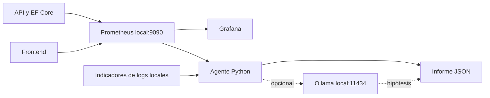

# Agente de diagnóstico y Grafana para TotalTech

Fecha: 23/10/2026. Extensión local de [Observabilidad](Observabilidad.md). Integra
el prototipo del kit en las rutas del proyecto, sin cambios de contratos de negocio,
instrumentación .NET, dependencias ni esquema de SQL Server.

## Diseño y entregas

1. Prometheus extrae las métricas existentes; Grafana consulta Prometheus y presenta
   ocho paneles. Datasource y dashboard tienen provisioning reproducible.
2. Un script Python consulta alertas `firing`, reúne evidencia y escribe informes
   JSON locales. No ejecuta reparaciones ni envía notificaciones.
3. Ollama puede interpretar los agregados opcionalmente. La correlación por solicitud
   y consulta EF Core queda como siguiente iteración; no se atribuye una causa SQL.



## Conectar Prometheus e importar el dashboard

Con API, Frontend y Prometheus iniciados según la guía existente, abrir Grafana.
Si ya existe una instancia en `http://127.0.0.1:3000`, usar esa instancia y sus
credenciales. No ejecutar otra copia en el mismo puerto.

Una sesión en `*.grafana.net` pertenece a Grafana Cloud y es independiente del login
de esta instalación local. Cloud no puede consultar directamente el Prometheus en
`127.0.0.1:9090` de esta PC. Usarlo requeriría una conexión privada adicional como
[PDC](https://grafana.com/docs/grafana-cloud/observe-and-act/connect-externally-hosted/private-data-source-connect/),
fuera de esta configuración local.

En **Connections → Add new connection → Prometheus**, crear el datasource:

| Campo | Valor |
|---|---|
| Nombre | `TotalTech Prometheus` |
| URL del servidor | `http://127.0.0.1:9090` |
| Autenticación hacia Prometheus | Ninguna, exclusivamente en el entorno local protegido |

Seleccionar **Save & test**. El plugin de Prometheus viene incluido en Grafana.
Esto no deshabilita la autenticación de usuarios de Grafana.

En **Dashboards → New → Import**, cargar
`Observabilidad/Grafana/dashboards/totaltech.json`. Seleccionar `TotalTech Prometheus`
en la variable **Prometheus** si fuera necesario. La variable busca el datasource por
nombre, por lo que admite el UID generado por una creación manual.

La [documentación de importación](https://grafana.com/docs/grafana/latest/visualizations/dashboards/build-dashboards/import-dashboards/)
describe la carga de JSON y las opciones de importación.

## Provisioning desde archivos

Para usar una instalación Windows de Grafana con el estado local del proyecto:

```powershell
.\Observabilidad\iniciar-grafana.ps1
```

El script usa por defecto `C:\Program Files\GrafanaLabs\grafana`, ejecuta en primer
plano y carga estos archivos sin copiarlos a Program Files:

| Archivo | Propósito |
|---|---|
| `Observabilidad/Grafana/grafana.ini` | Escucha loopback, conserva login, deshabilita registro público |
| `Observabilidad/Grafana/provisioning/datasources/prometheus.yml` | Datasource `TotalTech Prometheus`, UID `totaltech-prometheus`, extracción 15 s |
| `Observabilidad/Grafana/provisioning/dashboards/providers.yml` | Carpeta TotalTech y carga del JSON cada 30 s |
| `Observabilidad/Grafana/dashboards/totaltech.json` | Dashboard `totaltech-local` |

Datos internos de Grafana, plugins y logs se guardan bajo
`Desarrollo/logs/grafana/`, ignorado por Git. Es un estado independiente del servicio
Windows instalado y usa su propio login inicial; configurar la cuenta local desde
Grafana. No compartir este directorio, que contiene la base interna de Grafana.
La configuración deshabilita preinstalación y actualización automática de plugins;
Prometheus no necesita instalar plugins adicionales.

Para otra instalación o para coexistir con el servicio en 3000:

```powershell
.\Observabilidad\iniciar-grafana.ps1 -GrafanaHome 'C:\Herramientas\grafana' -Port 3001
```

Abrir `http://127.0.0.1:3001` en ese caso. Detener con **Ctrl+C** en su terminal.
El script restaura `TOTALTECH_GRAFANA_DASHBOARDS_PATH` al terminar y no administra
el servicio Windows existente.

Para provisioning en un servicio ya instalado, copiar los dos YAML a sus directorios
de provisioning correspondientes y definir `TOTALTECH_GRAFANA_DASHBOARDS_PATH` como
ruta absoluta a `Observabilidad/Grafana/dashboards` en el entorno **del proceso de
Grafana** antes de reiniciarlo. Una variable de otra terminal no llega a un servicio
Windows en ejecución. Mantener el mismo UID del datasource entre YAML y dashboard.
El script anterior automatiza esta configuración para su propia instancia.

El datasource provisionado y el dashboard se administran desde archivos; las
actualizaciones se hacen en el repositorio. Véase
[provisioning oficial](https://grafana.com/docs/grafana/latest/administration/provisioning/).

## Ocho paneles

| Panel | Lectura |
|---|---|
| Estado API | Último `up` del job API |
| Estado Frontend | Último `up` del job Frontend |
| Estado SQL | Última comprobación de conexión SQL |
| Errores HTTP 5xx (%) | Porcentaje por job en ventana de 5 min |
| Latencia p95 por ruta | Cinco mayores p95 estimados en segundos |
| Top rutas con 5xx / segundo | Cinco tasas positivas más altas |
| Latencia p95 EF Core | Histograma agregado de comandos SQL, en segundos |
| Fallos SQL / 5 minutos | Incremento del contador de errores en ventana de 5 min |

Los estados usan consultas instantáneas para no mostrar un valor histórico como
estado actual. Un panel sin datos no demuestra disponibilidad. Si existe tráfico y
ningún 5xx, el porcentaje muestra 0; sin solicitudes, el porcentaje no está definido.
El contador SQL reinicia con la aplicación y el panel muestra su incremento estimado,
no un historial persistente de incidentes.

```promql
topk(
  5,
  histogram_quantile(
    0.95,
    sum by (job, route, le) (
      rate(totaltech_http_request_duration_seconds_bucket{job=~"totaltech_api|totaltech_frontend"}[5m])
    )
  )
)
```

`rate` necesita dos extracciones como mínimo; p95 con poco tráfico es inestable.
Un top 5 evaluado en distintos instantes puede mostrar más de cinco rutas en la
leyenda de una gráfica histórica. Las alertas existentes requieren al menos 20
solicitudes en cinco minutos y una condición sostenida durante cinco minutos.

## Ejecutar el agente

Requiere Python 3.10 o posterior; utiliza solamente la biblioteca estándar.
Desde la raíz Git interna:

```powershell
python .\Observabilidad\AgenteDiagnostico\diagnostico.py --once
python .\Observabilidad\AgenteDiagnostico\diagnostico.py --watch --interval 30
```

La ejecución única es el valor predeterminado. No generar un informe cuando no hay
alertas pertinentes es normal. En vigilancia se genera un informe por episodio
`firing` de `TotaltechErroresElevados` o `TotaltechLatenciaElevada` para los jobs API y
Frontend. Se omiten `pending` y jobs ajenos. Tras recuperación se libera la deduplicación;
reiniciar el agente reinicia su memoria de episodios.

Cada informe se guarda en `Desarrollo/logs/diagnosticos/` e incluye alerta, job,
fecha UTC de consulta, inicio del episodio, rutas candidatas, PromQL, fallos parciales
y limitaciones. Todas las consultas del informe usan el mismo instante de evaluación.
No se elige como candidata una ruta con cero actividad, `NaN` o infinito.

Los logs `*.stdout.log` y `*.stderr.log` se buscan directamente en `Desarrollo/logs/`:
se consideran hasta 12 archivos modificados en los últimos 20 minutos y hasta 256 KB
y 400 líneas finales por archivo. Se cuentan indicadores; no se copian líneas.
La fecha de modificación del archivo no garantiza que las líneas pertenezcan al
episodio. `--logs-dir` y `--reports-dir` permiten elegir otros directorios.

Prometheus se consulta por HTTP exclusivamente en loopback:9090, con timeout de 6 s
y respuesta máxima de 2 MB por consulta. Se omiten proxies del entorno y se rechazan
redirecciones. Si una consulta de evidencia falla, el informe conserva las restantes.
Si falla la consulta de alertas, `--once` termina con código 1 y `--watch` vuelve a
intentar. El intervalo mínimo admitido es 15 s; consultas y análisis pueden prolongar
el tiempo entre ciclos. Los errores de escritura se informan como fallo del ciclo.

## Interpretación opcional con Ollama

Con un modelo instalado y probado previamente:

```powershell
python .\Observabilidad\AgenteDiagnostico\diagnostico.py --watch --interval 30 --ollama-model MI_MODELO_LOCAL
```

La solicitud usa `http://127.0.0.1:11434/api/generate`, formato JSON y `stream=false`,
según la [API oficial de Ollama](https://docs.ollama.com/api/generate).
Se envían agregados e indicadores, sin logs crudos, SQL ni parámetros. El resultado
queda marcado como hipótesis no verificada; si Ollama falla, se conserva el informe
determinista. No instala ni descarga modelos. Esta integración tiene pruebas con
respuestas simuladas; un modelo real requiere validación independiente.

## Pruebas reproducibles y evidencia

```powershell
python -m unittest discover -s Observabilidad/AgenteDiagnostico -p 'test_*.py' -v
$promtool = '.\ControlProyecto\prometheus-3.15.0.windows-amd64\prometheus-3.15.0.windows-amd64\promtool.exe'
& $promtool check config Observabilidad/prometheus.yml
& $promtool test rules Observabilidad/tests/alertas.test.yml
```

Las pruebas del agente simulan alertas y PromQL para verificar generación y
deduplicación de JSON, recuperación, datos insuficientes, fallos parciales, límites
de lectura, exclusión de etiquetas ajenas y errores de Ollama. Las pruebas de reglas
usan series sintéticas y cubren activación, recuperación, mínimo de tráfico y jobs
ajenos. No provocan fallos ni alteran la base de negocio. El workflow
`.github/workflows/diagnostico-ci.yml` ejecuta la suite Python sin SQL ni modelos.

En entornos restringidos donde el directorio temporal del sistema no sea escribible,
seleccionar una carpeta local antes de las pruebas:

```powershell
$env:TEMP = Join-Path $PWD 'Desarrollo/logs/tests-python'
$env:TMP = $env:TEMP
New-Item -ItemType Directory -Path $env:TEMP -Force | Out-Null
python -m unittest discover -s Observabilidad/AgenteDiagnostico -p 'test_*.py' -v
```

El ejemplo `Observabilidad/AgenteDiagnostico/ejemplos/incidente-simulado.json` es
evidencia **sintética** del formato; sus cifras no son mediciones de TotalTech.

Validación local del 23/10/2026:

- 13 pruebas Python aprobadas con Python 3.14.7. El primer intento encontró permisos
  insuficientes en el temporal del entorno aislado; pasó al usar un temporal dentro
  de `Desarrollo/logs/`.
- `promtool 3.15.0`: configuración y cuatro reglas existentes válidas; los escenarios
  de alertas aprobados. Las 12 expresiones del dashboard y del agente también pasaron
  el parser de PromQL mediante reglas temporales de validación.
- Prometheus existente respondió `ready`; sus tres targets (API, Frontend y
  Prometheus) figuraron `UP`. El agente ejecutó `--once` contra esa instancia y terminó
  con código 0, sin generar incidentes artificiales.
- Instancia independiente de Grafana 13.2.4 en `127.0.0.1:3001`: `/api/health` indicó
  `database=ok`; los logs registraron inserción del datasource y finalización del
  provisioning de dashboards. No se autenticó esta comprobación ni se ejecutó
  **Save & test** o validación visual de los paneles.
  La instancia temporal se detuvo al terminar la validación final.
- La instancia existente de Grafana en 3000 requiere iniciar sesión para completar
  la configuración manual. Su servicio y sus datos se conservaron. La autenticación
  de una prueba por API fue rechazada por la revisión automática por intentar leer
  credenciales de configuración; no se accedió mediante ese procedimiento.
- No se ejecutó CI remoto ni un modelo real de Ollama. No se requirieron builds .NET:
  no cambió el código de la API ni del Frontend.

Para la entrega académica, adjuntar capturas de Save & test, los ocho paneles y una
alerta reproducida junto al informe correspondiente. Distinguir siempre simulación
de mediciones operativas y anotar ventana temporal y tráfico. Una captura de login
o de servicio saludable no demuestra que el dashboard esté conectado.

## Correlación EF Core pendiente

`ProductosRepositorio.ObtenerCatalogoAsync` puede etiquetar su LINQ con
`TagWith("TotalTech.Productos.ObtenerCatalogo")`. Esa etiqueta por sí sola no llega
a las métricas actuales. La siguiente iteración debe emitir eventos estructurados
de comandos lentos con `operation_id` de una lista permitida, duración, tipo de
ejecución, resultado y `trace_id`, correlacionados con la solicitud HTTP.

No usar SQL completo, parámetros, IDs de cliente o trazas como etiquetas Prometheus.
Mientras no exista esa correlación, el agente sólo prioriza rutas y propone
verificaciones; no demuestra qué consulta causó una demora. La revisión del plan de
ejecución requiere evidencia adicional y acceso de solo lectura específico.

UC-46 sigue parcial: faltan notificaciones externas, correlación por consulta y
validación para producción. La configuración sin autenticación de Prometheus está
limitada al entorno local protegido.
