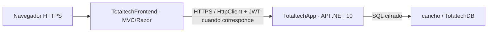

# TotalTech en Azure: despliegue full stack

Fecha de trabajo: 28/10/2026, America/Buenos_Aires. Rama: Rama--Facu. Base de los cambios: 4bb94b4; implementación publicada en b98d9d8. **El flujo MVC → API → SQL está operativo y probado. El alcance integral sigue PARCIALMENTE completado por las diferencias conocidas de Pedidos y las funciones deshabilitadas/no verificadas.**

## Resultado ejecutivo

- Frontend público HTTPS operativo, con 6 categorías y los 11 productos originales. Home, catálogo, detalle, contacto, garantía, login, registro, CSS y JavaScript devolvieron HTTP 200.
- Registro, duplicado, login válido/inválido, logout, roles, CSRF e invalidación por baja: PASS con datos dedicados autorizados.
- Sesiones de cliente y administrador, producto, carrito y dos imágenes: conservados tras reinicio y redeploy del mismo paquete frontend.
- Pipeline frontend completo con OIDC: PASS en [ejecución 40746660793](https://github.com/PracticasProfesionalizantes-II-2026/Grupo-N-1---SistemaVentaDeProductosTecnologicos/actions/runs/40746660793), SHA b98d9d869edc9bc1b7adc8e545733e3d5043f997. Todos los gates, publish, login, deploy y smoke terminaron correctamente.
- Lote TT-AZURE-20261028 limpiado: producto 12, carrito 11 y dos imágenes eliminados; cliente 15 inactivo y su auditoría conservada. Los productos comerciales coinciden exactamente con el JSON público inicial; pedidos y pagos conservaron sus conteos.

## Arquitectura e inventario



| Recurso | Configuración real |
|---|---|
| Suscripción / grupo | Azure for Students / Servidores |
| Plan compartido | ASP-Servidores-a321, Windows F1, Brazil South |
| Frontend | https://totaltechfrontend.azurewebsites.net/ |
| Backend | https://totaltechapp-ghd2etambcgcfgcb.brazilsouth-01.azurewebsites.net/ |
| Base | TotatechDB en cancho.database.windows.net |
| Identidad de despliegue | TotaltechApp-id-a411, federada con Rama--Facu |

El frontend y la asignación Website Contributor limitada a esa Web App fueron autorizados específicamente. No se creó otro plan ni se cambió de SKU. HTTPS Only, TLS/SCM TLS 1.2, FTP y publicación básica deshabilitados. Runtime .NET 10.

## Configuración sin secretos

Frontend:

| Variable | Valor |
|---|---|
| ASPNETCORE_ENVIRONMENT | Production |
| ApiBaseUrl | URL HTTPS del backend con barra final |
| ApiTimeoutSeconds | 60 |
| Observability__Enabled | false |
| CompraDemo__Enabled | false |
| ProductoImagenes__Directorio | %HOME%\data\Totaltech\productos |
| WEBSITE_RUN_FROM_PACKAGE | 1 |

Los clientes TotaltechApi y TotaltechSessionApi usan la misma URI validada y timeout. Las rutas son relativas para conservar posibles prefijos. No hay acceso SQL directo en MVC. La clave JWT y la conexión SQL existen únicamente en la configuración privada de la API.

La cookie MVC conserva HttpOnly y SameSite=Lax y exige Secure en Production. Los tokens se guardan en las propiedades protegidas de la cookie; nunca en HTML/JavaScript. ASP.NET Core en App Service persiste por defecto las claves Data Protection en %HOME%/ASP.NET/DataProtection-Keys. La persistencia real de sesión después de reinicio debe probarse con una cuenta autorizada.

Uploads: directorio configurable absoluto, expansión de variables validada, nombres GUID y mismos controles de tamaño (5 MB), extensión, MIME y firma. Solo JPG/PNG/WebP se sirven en /uploads/productos/, con nosniff y sin listado. Están fuera del paquete read-only; no requieren Blob ni cambios de esquema. Las imágenes estáticas siguen en wwwroot y los valores null conservan placeholder/resolver existentes.

## Cambios y build

- Configuración API compartida y validada, cookies Production y middleware de uploads externos.
- Servicios HTTP mantienen los endpoints y usan rutas relativas.
- Workflow frontend separado y validación .NET reutilizable.
- Clasificación E2E de los tres tests Chromium omitidos por la clasificación anterior; serialización de pruebas que comparten capturas y fixture.
- Tests de configuración Production, servicio de uploads entre hosts y SQL de compatibilidad.
- Scripts reproducibles de aprovisionamiento y smoke test; SQL revisable y documentación.

```powershell
dotnet restore ./Frontend/Frontend.csproj
dotnet build ./Grupo-N-1---SistemaVentaDeProductosTecnologicos.sln -c Release --no-restore
dotnet publish ./Frontend/Frontend.csproj -c Release --no-build --no-restore -o ./publish/frontend
dotnet test ./Grupo-N-1---SistemaVentaDeProductosTecnologicos.sln -c Release --no-build --no-restore --filter "Category!=SqlServer&Category!=E2E"
dotnet test ./Tests/Totaltech.IntegrationTests/Totaltech.IntegrationTests.csproj -c Release --no-build --no-restore --filter "Category=SqlServer"
dotnet test ./Tests/Totaltech.IntegrationTests/Totaltech.IntegrationTests.csproj -c Release --no-build --no-restore --filter "Category=E2E"
```

La publicación contiene Frontend.dll, deps/runtimeconfig, web.config y wwwroot; no contiene Totaltech.dll. El web.config generado apunta a dotnet / .\Frontend.dll con AspNetCoreModuleV2 inprocess.

## CI/CD y publicación

El workflow rama--facu_totaltechfrontend.yml escucha push a Rama--Facu y workflow_dispatch. Invoca dotnet-ci.yml, que mantiene CI directo para main/Develop y PR existentes, evitando duplicar el trigger de Rama--Facu.

Gates: build y pruebas rápidas, SQL en bases LocalDB desechables y navegador con Chromium instalado, además de validación Prometheus existente. No hay continue-on-error. Después se publica únicamente Frontend.csproj, valida contenido, sube un artefacto independiente y despliega con azure/login OIDC y azure/webapps-deploy. Los despliegues frontend se serializan.

Issuer: https://token.actions.githubusercontent.com; audience: api://AzureADTokenExchange; subject: repo:PracticasProfesionalizantes-II-2026/Grupo-N-1---SistemaVentaDeProductosTecnologicos:ref:refs/heads/Rama--Facu. Se reutilizan las referencias de configuración de identidad existentes. No se usan publish profiles ni contraseñas de publicación.

El workflow backend conserva destino, OIDC, build y deploy. Se agregó un filtro de rutas Totaltech/**, Observabilidad/Instrumentacion/** y global.json para respetar la instrucción posterior de no redesplegar la API por un cambio de frontend/documentación. Conserva workflow_dispatch. El smoke test comprueba API, HTML MVC con un producto real, CSS y cantidades; HTTP 200 de una página vacía no es suficiente.

Estado GitHub previo: deploy backend exitoso en 4bb94b4; CI .NET falló en fast-tests porque incluía tests que necesitaban Chromium. El job de diagnóstico también falló: su reloj produjo nombres de informe iguales en dos incidentes consecutivos (test_recuperacion_y_nuevo_incidente, 1 archivo en vez de 2). Sus 13 tests pasaron localmente en Python 3.14 y la ejecución posterior de diagnóstico en b98d9d8 pasó. La colisión de timestamps sigue como riesgo intermitente; no se deshabilitó ni se modificó ese agente.

Durante el trabajo apareció el commit b98d9d8 publicado externamente, que incorporó los 24 archivos preparados. Su pipeline backend se ejecutó automáticamente el 28/10 a partir de 18:36 UTC y terminó exitosamente; no se inició ese deploy manualmente. La instrucción controlada posterior del lote prohíbe repetirlo, por lo que las operaciones del lote se limitaron al frontend y el filtro de rutas evita repetirlo con el próximo push.

Despliegue manual inicial: f119555fea9945e499be3190cde8c593. Redeploy del mismo ZIP: 540ccc640dea4ba89b526d637cd5af34. SHA256 del ZIP validado: A2E9FC4B95712D9A4C524F3152300E944404F45271E1CCD1306D9A62AD454E51. El redeploy conservó el artefacto y no incorporó cambios de aplicación.

## Azure SQL

Se conserva Database__ApplyMigrations=false. El historial mantiene cinco migraciones de junio y no coincide con la baseline actual. No se ejecutó la nueva migración inicial ni se modificó __EFMigrationsHistory.

- ImagenUrl nvarchar(500) NULL: reparación anterior aplicada; catálogo con 11 productos y 6 categorías.
- Compatibilidad de usuarios: aplicada con autorización el 28/10/2026 18:26:27 UTC. Se agregaron Activo=true y VersionSesion=1 a los 14 registros históricos y AuditoriaUsuarios con sus índices/FK. Datos existentes verificados sin cambios; auditoría inicialmente vacía, historial con 5 registros.
- Antes de ese cambio se verificó respaldo CONTINUOUS con retención de 7 días y se registró 18:11:22 UTC como referencia previa. No se ensayó una restauración completa.
- Pedidos todavía carece de IdCarrito, Total y seis campos de dirección. También falta su FK/índice a carrito. CHECKs de Total y Stock del modelo actual no figuran en la base.
- Ver matriz completa en SQL/Comparacion-esquema-20261028.md. La igualdad de columnas no demuestra por sí sola igualdad de defaults, índices, reglas y datos.

Compras de demostración permanecen deshabilitadas. Administración puede mostrar información parcial de pedidos; no afirmar que checkout/pedidos productivos están listos. La conciliación restante requiere aprobación y pruebas específicas.

## Matriz de validación

| Prueba | Estado | Evidencia / límite |
|---|---|---|
| Restore y build Release | PASS | 0 errores, 0 warnings |
| Publish exclusivamente MVC | PASS | DLL y web.config inspeccionados |
| Unitarias | PASS | 21 |
| Integración rápida | PASS | 193, incluyendo Production y uploads |
| SQL Server aislado | PASS | 30, incluyendo reparación/idempotencia |
| Agente Python local | PASS | 13 en Python 3.14; CI histórico falló |
| Workflow YAML/expresiones | PASS | actionlint 1.7.12, checksum oficial verificado |
| E2E navegador | PASS | 41 en la corrida completa aislada; también PASS en GitHub. Corridas iniciales fallaron y se corrigió aislamiento, sin omitir pruebas |
| Production local → API Azure → SQL | PASS | Home, catálogo y CSS 200; producto real de API en HTML |
| Frontend público / OIDC del nuevo pipeline | PASS | Ejecución 40746660793, b98d9d8; smoke con datos reales |
| Registro/login/logout Azure | PASS | Cliente dedicado 15; contraseña solo en memoria |
| Rol administrador Azure | PASS | Cuenta existente ingresada por el usuario; producto/imagen y baja del cliente dedicado desde MVC |
| Persistencia upload/sesión tras reinicio y redeploy | PASS | Cliente y administrador, producto 12, carrito 11, dos PNG accesibles |
| CSRF / autorización / revocación | PASS | Logout sin token 400; cliente sin admin; tras baja cookie redirige, JWT 401 y login 403 |
| Limpieza e integridad del lote | PASS | Ver Pruebas-Azure-DatosDedicados.md; productos comerciales idénticos |
| CompraDemo/pagos productivos | N/A para demo | Deshabilitados; pruebas completas solo en LocalDB aislado |

Registrar cada resultado nuevo con hora, SHA, URL de Actions y limitaciones. Los TRX y capturas están en Tests/*/TestResults, ignorados por Git.

## Operación, costos y recuperación

F1 informa capacidad de hasta 10 apps, 1 GB de almacenamiento, 1 GB de memoria y 60 minutos CPU diarios. Antes del frontend había 1 app, aproximadamente 30 MB usados y unos 234 segundos CPU reportados. Son cuotas/mediciones, no garantías de disponibilidad. Sin Always On ni slots; prever cold starts.

SQL existente: General Purpose Serverless Gen5, capacidad máxima 2, mínima 0.5, 32 GB, autoPauseDelay=60 minutos, useFreeLimit=true y freeLimitExhaustionBehavior=AutoPause. No se modificaron esos valores ni se habilitaron extras. El agotamiento de la franquicia puede pausar el servicio. No afirmar costo total cero ni cambiar la política de agotamiento.

Diagnóstico:

1. Comparar /categorias/ y /productos/catalogo con el frontend.
2. Descargar logs con az webapp log download para cada app; revisar LogFiles/eventlog.xml, primer evento relevante .NET Runtime/IIS AspNetCore Module V2.
3. Consultar nombres/presencia de settings, runtime, permisos OIDC y estado SQL, sin imprimir valores privados.
4. No habilitar Development ni exponer /metrics. Observability sigue false.

Contingencia manual autorizada: generar ZIP de publish/frontend y desplegarlo mediante az webapp deploy -g Servidores -n TotaltechFrontend --src-path ./publish/frontend-ready.zip --type zip, usando Entra ID. Esto no acredita OIDC de GitHub; registrar la diferencia.

Rollback: conservar el último paquete frontend verificado y redeployarlo con las mismas variables. Los uploads externos y claves Data Protection no se incluyen ni eliminan en el ZIP. No borrar columnas ni restablecer SQL automáticamente. Una restauración SQL requiere autorización y crea otra base antes de cambiar conexiones.

## Pendientes priorizados

P0 completado en b98d9d8: frontend público y pipeline sobre SHA identificado. Los cambios documentales/operativos posteriores se registran con su propio commit, sin atribuirles un artefacto de aplicación diferente.

P1 del lote completado: pruebas de escritura dedicadas, autenticación privada, persistencia real después de reinicio/redeploy y auditoría conservada. No se elevaron cuentas ni se borraron datos comerciales. No implica cobertura de módulos que siguen deshabilitados o desalineados.

P2: conciliación restante de Pedidos, constraints e historial; corrección separada de la colisión temporal del agente diagnóstico; observabilidad avanzada sin servicios pagos automáticos.
