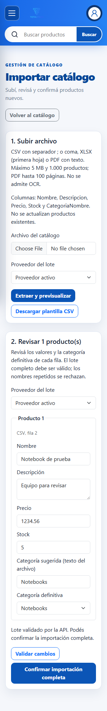
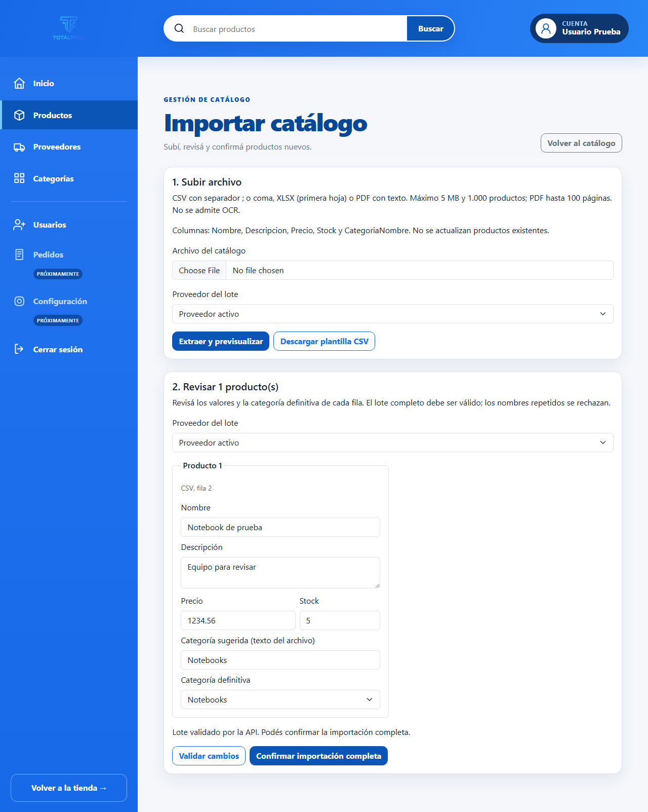

# Entrega: desarrollo de UC-28 con un agente de IA

| Dato | Descripción |
|---|---|
| Proyecto | TotalTech — Sistema de venta de productos tecnológicos. |
| Integrantes | Daiana Chinellato y Facundo Sola. |
| Fecha de elaboración | 30/10/2026. |
| Opción elegida | Agilizar y agregar calidad al proceso de desarrollo de la aplicación. |
| Estado | Implementación Frontend y pruebas preparadas en el repositorio local; integración Backend pendiente. Este documento no acredita una publicación en GitHub. |

## 1. Consigna e idea elegida

La consigna propone pensar una idea que aplique conceptos de IA a una de dos opciones:

1. Agilizar o mejorar el desarrollo, agregando una funcionalidad al proyecto existente con IA.
2. Automatizar una funcionalidad de negocio desde el punto de vista del usuario.

Además, pide implementar la idea con una herramienta investigada y entregar la explicación en Markdown —u otro formato elegido— en el mismo repositorio de la aplicación.

Elegimos la **primera opción**: utilizar un agente de desarrollo para crear el Frontend del caso de uso **UC-28, importación administrativa de catálogo**. La funcionalidad permite subir CSV, XLSX o PDF, extraer productos, corregir sus datos y preparar un lote para validarlo y confirmarlo mediante la API.

La implementación nueva de este alcance —código Frontend y pruebas agregadas— fue generada con **Codex**, a partir de instrucciones y decisiones humanas. El proyecto TotalTech, su arquitectura y sus funcionalidades anteriores ya existían. No se afirma que la aplicación completa haya sido creada con IA, ni que el trabajo haya carecido de supervisión humana.

La referencia de la consigna a la clase del **23/10** corresponde al momento solicitado para pensar la idea. Esta entrega está fechada el **30/10/2026** y no acredita una presentación anterior.

## 2. Herramienta investigada y conceptos aplicados

Se utilizó **Codex**, el agente de desarrollo de OpenAI, desde su aplicación de escritorio sobre el repositorio local. La documentación oficial lo describe como un agente para escribir, revisar y depurar código: [Code generation — OpenAI](https://developers.openai.com/api/docs/guides/code-generation).

En esta implementación, el agente leyó archivos, propuso un plan, generó cambios, ejecutó comandos de compilación y pruebas, analizó fallos y corrigió el resultado. La persona responsable definió el objetivo y el alcance, eligió entre alternativas y solicitó la implementación del plan acordado.

| Concepto | Aplicación concreta en TotalTech |
|---|---|
| Agente con herramientas | Codex inspeccionó el repositorio, editó archivos y ejecutó `dotnet`, Git y verificaciones en navegador. |
| Instrucciones mediante prompts | El pedido definió formatos, archivos, límites, protección de las acciones y pruebas esperadas. |
| Contexto del repositorio | Se consultaron arquitectura, servicios HTTP, modelos, vistas, contratos y pruebas existentes antes de implementar. |
| Instrucciones persistentes | [AGENTS.md](../AGENTS.md) y los perfiles del proyecto fijaron responsabilidades, alcance y Quality Gates. |
| Validación automatizada | Se compilaron los proyectos y se ejecutaron pruebas del extractor, MVC, HTTP y navegador. |
| Supervisión humana | Se acordaron biblioteca PDF, política de importación, proveedor común, categorías, duplicados y dependencia Backend. |

`AGENTS.md` aporta instrucciones duraderas del repositorio, como también explica la [guía oficial de flujos de desarrollo con Codex](https://developers.openai.com/cookbook/examples/codex/iterating-development-workflows-with-codex). En TotalTech, los perfiles [Frontend](../ControlProyecto/Frontend.md), [Backend](../ControlProyecto/Backend.md) y [Auditor](../ControlProyecto/Auditor.md) fueron documentos de instrucciones consultados por **un mismo agente principal**. No se ejecutaron como tres agentes autónomos ni se creó una skill nueva para esta entrega.

La IA intervino en **el desarrollo del software**. Durante el uso de la aplicación, la extracción PDF utiliza PdfPig y reglas locales deterministas; actualmente no invoca un modelo de IA. La interfaz `ICatalogoExtractorAgent` permite reemplazar el normalizador, pero su nombre por sí solo no implica el uso de IA.

## 3. Pedido original y decisiones acordadas

El siguiente fue el pedido inicial utilizado para orientar la implementación:

```markdown
Actúa bajo el manifiesto AGENTS.md combinando los perfiles ControlProyecto/Frontend.md, ControlProyecto/Backend.md y ControlProyecto/Auditor.md.

Objetivo: Implementar en Frontend la interfaz administrativa de subida, extracción multi-formato (CSV, XLSX y PDF con agente/heurística de normalización) y confirmación de catálogo (UC-28).

Alcance autorizado en Frontend/ y Tests/:
1. Crear los modelos espejo en `Frontend/Models/Api/Requests/` y `Frontend/Models/Api/Responses/`, y el ViewModel `Frontend/Models/ViewModels/Productos/ProductoImportacionViewModel.cs`.
2. Crear `Frontend/Services/CatalogoArchivoExtractor.cs` (y registrarlo en `Frontend/Program.cs`):
   - Límite estricto de lectura en stream de 5 MB (siguiendo el patrón de `ProductoImagenStorage.cs`).
   - Soporte `.csv` (autodetectando `;` y `,`).
   - Soporte `.xlsx` nativo mediante `ZipArchive` y `XDocument` (`sharedStrings.xml` + `sheet1.xml`) sin añadir dependencias NuGet externas.
   - Soporte `.pdf` extrayendo líneas de productos y normalizando `Nombre`, `Descripcion`, `Precio`, `Stock` y sugerencia de `CategoriaNombre` mediante `ICatalogoExtractorAgent` (con fallback heurístico local determinista para funcionar offline en tests y demos).
3. Extender `Frontend/Services/ProductosApiService.cs` con `PrevisualizarImportacionAsync` y `ConfirmarImportacionAsync`.
4. En `Frontend/Controllers/ProductosController.cs` (`[Authorize(Roles = "Admin")]`):
   - Agregar `GET Importar()`, `GET PlantillaImportacionCsv()`, `POST PrevisualizarImportacion(...)` y `POST ConfirmarImportacion(...)` con `[ValidateAntiForgeryToken]` y manejo resiliente de `HttpRequestException` y `TaskCanceledException`.
5. Crear `Frontend/Views/Productos/Importar.cshtml` respetando la estética del panel administrativo y agregar botones de acceso en `Frontend/Views/Administracion/Index.cshtml` y `Frontend/Views/Productos/Index.cshtml` (solo para rol Admin).
6. Agregar pruebas unitarias del extractor CSV/XLSX/PDF en `Tests/Frontend.UnitTests/` y ejecutar los Quality Gates (`dotnet build` y `dotnet test`).
```

La exploración mostró que no existían endpoints ni DTOs Backend de importación en esta rama. Antes de generar el código se acordaron estas precisiones:

| Decisión humana | Resultado aplicado |
|---|---|
| Mantener el alcance en Frontend y Tests | Se definió un contrato propuesto y un handoff; no se implementó persistencia Backend. |
| Autorizar PdfPig para PDF | Se agregó PdfPig 0.1.16. CSV y XLSX continúan usando APIs nativas de .NET. |
| Realizar solo altas nuevas | La operación no actualiza productos existentes. La atomicidad del lote es un requisito del Backend pendiente. |
| Usar un proveedor común | Se selecciona un proveedor activo para todo el lote. |
| Revisar categorías por producto | Cada fila muestra la sugerencia y permite elegir una categoría existente. |
| Rechazar nombres repetidos | El Frontend detecta duplicados dentro del lote; la comparación con el catálogo existente corresponde al Backend. |

Las acciones nuevas requieren Admin y los dos POST tienen antiforgery. El catálogo público conserva su acceso anterior. El plan fue aprobado mediante el pedido explícito de implementación.

## 4. Proceso realizado con el agente

1. **Exploración:** se confirmó la raíz Git interior, la rama y el estado local. Se leyeron las instrucciones y los consumidores existentes, incluyendo el patrón de lectura acotada de imágenes y el cliente `TotaltechApi`.
2. **Planificación:** se identificó la ausencia del contrato Backend y se acordaron las decisiones anteriores. No se inventó una integración persistente para completar la pantalla.
3. **Generación:** Codex creó modelos, extractor, normalizador heurístico, acciones MVC, vista, accesos y pruebas, preservando ASP.NET Core MVC/Razor y el cliente HTTP del proyecto.
4. **Pruebas y correcciones:** se verificaron límites, formatos, errores y cancelación. Se corrigió una preparación de `ModelState` en una prueba unitaria para representar la validación que realiza MVC.
5. **Revisión visual:** las pruebas de navegador detectaron un aviso de validación vacío, que se corrigió en la vista. También se ajustó el puente entre Chromium y TestServer para representar las redirecciones sin un servidor público; la respuesta HTTP de redirección se prueba por separado.
6. **Verificación final:** se compilaron los proyectos, se ejecutaron las suites aplicables y se revisaron el diff, los conflictos y la presentación responsive.

El agente produjo tanto código como pruebas. Por ese motivo se combinaron pruebas unitarias con verificaciones HTTP y visuales: el resultado no se aceptó únicamente por haber sido generado por IA.

## 5. Implementación y archivos de evidencia

| Componente | Evidencia en el repositorio |
|---|---|
| Extracción y límites | [CatalogoArchivoExtractor.cs](../Frontend/Services/CatalogoArchivoExtractor.cs) |
| Interfaz y normalizador PDF local | [ICatalogoExtractorAgent.cs](../Frontend/Services/Interfaces/ICatalogoExtractorAgent.cs), [CatalogoExtractorHeuristico.cs](../Frontend/Services/CatalogoExtractorHeuristico.cs) |
| Normalización numérica y de nombres | [CatalogoImportacionNormalizador.cs](../Frontend/Services/CatalogoImportacionNormalizador.cs) |
| Contratos HTTP propuestos | [Requests](../Frontend/Models/Api/Requests/ProductoImportacionRequest.cs), [Responses](../Frontend/Models/Api/Responses/ProductoImportacionResponse.cs) |
| Estado editable de la pantalla | [ProductoImportacionViewModel.cs](../Frontend/Models/ViewModels/Productos/ProductoImportacionViewModel.cs) |
| Coordinación MVC y cliente HTTP | [ProductosController.Importacion.cs](../Frontend/Controllers/ProductosController.Importacion.cs), [ProductosApiService.cs](../Frontend/Services/ProductosApiService.cs) |
| Vista e interacción | [Importar.cshtml](../Frontend/Views/Productos/Importar.cshtml), [productos-importacion.js](../Frontend/wwwroot/js/productos-importacion.js) |
| Contrato y garantías Backend pendientes | [UC28-CONTRATO-BACKEND.md](../Frontend/UC28-CONTRATO-BACKEND.md) |

El flujo implementado es **subir → extraer → revisar → validar con la API → solicitar confirmación**. La pantalla conserva errores y datos editables; no comunica éxito cuando faltan los endpoints o cuando el resultado del envío es incierto.

## 6. Validaciones ejecutadas

Los siguientes resultados corresponden a la implementación verificada el **30/10/2026**, antes de agregar esta documentación. No representan una nueva ejecución causada por la redacción del Markdown.

| Verificación | Resultado observado |
|---|---|
| Restauración y build de la solución | Correctos; cero errores y dos advertencias NuGet descritas debajo. |
| Build de la nueva suite Frontend.UnitTests | Correcto, sin advertencias ni errores. |
| Nueva suite unitaria Frontend | **77 aprobadas**, sin fallos ni omisiones. |
| Pruebas del área Frontend en la suite de integración | **143 aprobadas**, sin fallos ni omisiones. Incluyen 136 existentes y 7 agregadas para UC-28. |
| Suite unitaria existente Totaltech.UnitTests | **21 aprobadas**, sin fallos ni omisiones. |
| Total de pruebas de las suites ejecutadas | **241 aprobadas**. No equivale a ejecutar toda la suite relacional o E2E del proyecto. |
| Chromium y responsive | Revisión en 320, 375, 425, 768, 1024 y 1280 px; sin overflow horizontal en esos anchos. |
| Accesibilidad e interacción verificadas | Labels asociados, errores enlazados a campos, edición por teclado e invalidación del botón de confirmación tras cambios. No constituye una auditoría WCAG completa. |
| Git | `git diff --check` correcto y revisión del alcance de los cambios. |

### Qué cubren las pruebas

- [Extractor](../Tests/Frontend.UnitTests/CatalogoArchivoExtractorTests.cs): separadores y comillas CSV, BOM, números ambiguos, celdas XLSX dispersas, shared strings, fórmulas no evaluadas, XML excesivo, PDF real generado en memoria, varias páginas, agente inyectado, fallback y cancelación. Incluye tamaño declarado falso, stream no posicionable y lectura efectiva limitada a 5 MiB más el byte de detección.
- [Servicios y MVC](../Tests/Frontend.UnitTests/ProductoImportacionTests.cs): serialización, categorías, duplicados locales, conservación de datos, errores de API, timeout y confirmación incierta.
- [HTTP](../Tests/Totaltech.IntegrationTests/Frontend/ProductoImportacionHttpTests.cs): autorización Admin, antiforgery, subida y revisión, API ausente, redirección tras confirmación y binding completo de 1.000 filas.
- [Navegador](../Tests/Totaltech.IntegrationTests/Frontend/ProductoImportacionVisualTests.cs): carga de CSV, edición por teclado, revalidación, confirmación con API simulada y capturas responsive.

**Advertencias conocidas:** la restauración detectó `NU1902` y `NU1903` para `System.Security.Cryptography.Pkcs 9.0.4`. La cadena inspeccionada fue `Totaltech → Microsoft.EntityFrameworkCore.SqlServer 10.0.7 → Microsoft.Data.SqlClient 6.1.1 → System.Security.Cryptography.Pkcs 9.0.4`. Es una dependencia existente del Backend; PdfPig no incorpora esa cadena. No se actualizaron paquetes ajenos al alcance para ocultar las advertencias.

### Comandos para reproducir la validación

Ejecutar desde la raíz que contiene `AGENTS.md`, `Frontend/`, `Totaltech/` y `Tests/`, con el SDK .NET 10 instalado:

```powershell
dotnet restore Grupo-N-1---SistemaVentaDeProductosTecnologicos.sln
dotnet build Grupo-N-1---SistemaVentaDeProductosTecnologicos.sln --no-restore

dotnet restore Tests/Frontend.UnitTests/Frontend.UnitTests.csproj
dotnet build Tests/Frontend.UnitTests/Frontend.UnitTests.csproj --no-restore
dotnet test Tests/Frontend.UnitTests/Frontend.UnitTests.csproj --no-build --no-restore

dotnet test Tests/Totaltech.UnitTests/Totaltech.UnitTests.csproj --no-build --no-restore
dotnet test Tests/Totaltech.IntegrationTests/Totaltech.IntegrationTests.csproj --no-build --no-restore --filter FullyQualifiedName~Totaltech.IntegrationTests.Frontend

git diff --check
git status --short
```

La suite nueva se ejecuta explícitamente porque no fue agregada a la solución. Las pruebas UC-28 usan una **API simulada** y no requieren SQL Server ni un agente remoto. La verificación de navegador necesita Chromium de Playwright; si no está instalado, después del build de integración puede instalarse con:

```powershell
powershell -ExecutionPolicy Bypass -File Tests/Totaltech.IntegrationTests/bin/Debug/net10.0/playwright.ps1 install chromium
```

## 7. Guion de demostración

### Ejemplo CSV

Guardar el siguiente texto en UTF-8 como `catalogo-demo.csv`; también se puede descargar la plantilla desde la pantalla:

```csv
Nombre;Descripcion;Precio;Stock;CategoriaNombre
Notebook demo UC28;Equipo portátil para demostración;1234,56;5;Notebooks
Mouse demo UC28;Mouse inalámbrico;12500,00;10;Periféricos
```

Los nombres de categoría son sugerencias. Para validar se deben seleccionar categorías existentes y un proveedor activo.

### Recorrido en la aplicación

1. Usar el [inicio local documentado del proyecto](DesarrolloLocal.md), con API y Frontend disponibles para autenticar una cuenta Admin. No se necesita una clave de un proveedor de IA para extraer el archivo.
2. Abrir **Productos → Importar catálogo**, elegir el CSV y un proveedor activo, y pulsar **Extraer y previsualizar**.
3. Mostrar las filas extraídas, el origen, el precio normalizado y la categoría definitiva editable.
4. Cambiar un precio por `1.234` o el stock por texto y pulsar **Validar cambios**. Mostrar el error y comprobar que el valor se conserva para corregirlo. Repetir un nombre permite mostrar la detección de duplicados locales.
5. Corregir el dato y revisar las categorías. Como los endpoints Backend de importación están pendientes, la aplicación actual mostrará que la validación Backend no está disponible y mantendrá deshabilitada la confirmación. Si alguna fila aún tiene errores locales, primero mostrará esos errores.
6. Mostrar las pruebas HTTP y de navegador para explicar el recorrido completo **con API simulada**, donde una validación aceptada permite confirmar y se verifica la respuesta y redirección.

La extracción local y sus pruebas funcionan sin un modelo remoto. La navegación autenticada conserva los requisitos de sesión y servicios del proyecto; no se presenta como una aplicación completamente offline.

Para ejecutar solo la demostración automatizada de UC-28, después del build:

```powershell
dotnet test Tests/Totaltech.IntegrationTests/Totaltech.IntegrationTests.csproj --no-build --no-restore --filter FullyQualifiedName~ProductoImportacion
```

La API simulada devuelve los contratos esperados para comprobar al consumidor Frontend. **No demuestra que se hayan insertado productos en una base de datos ni que exista atomicidad o idempotencia persistente.**

## 8. Capturas de la verificación

Estas capturas fueron obtenidas por la prueba de navegador con **API simulada**. Por eso muestran el lote validado y la confirmación habilitada. Se copiaron a esta carpeta documental porque los originales de `TestResults/` están ignorados por Git.

### Móvil — 320 px



### Escritorio — 1280 px



Las imágenes y sus enlaces quedarán disponibles junto al Markdown al incorporar estos archivos al mismo repositorio de GitHub. Su presencia local no implica que ya se hayan publicado.

## 9. Límites de la entrega

- **Alcance implementado:** Frontend, extracción local, contratos cliente y pruebas. Los endpoints `/productos/importacion/previsualizar` y `/productos/importacion/confirmar` todavía no están implementados en el Backend de esta entrega.
- **Garantías pendientes:** comprobación contra productos existentes, persistencia atómica, idempotencia y corrección bajo concurrencia deben implementarse y verificarse en Backend según el [handoff](../Frontend/UC28-CONTRATO-BACKEND.md).
- **IA durante el uso:** no hay un modelo interpretando PDFs; la implementación actual de `ICatalogoExtractorAgent` es heurística y determinista. La opción elegida de la consigna se refiere al desarrollo con IA.
- **Formatos:** PDF requiere texto extraíble y formatos interpretables; no hay OCR ni interpretación universal de tablas. XLSX lee `sheet1.xml` y no evalúa fórmulas.
- **Límites técnicos:** archivo de hasta 5 MiB reales, hasta 1.000 productos, PDF de hasta 100 páginas y hasta 20 MiB acumulados de XML XLSX descomprimido.
- **Publicación:** esta tarea deja documentación e implementación preparadas localmente. No se realizó commit ni push como parte de la entrega documental.

## 10. Conclusiones

Se aplicó un agente de IA a una tarea concreta dentro de una aplicación existente: producir una interfaz administrativa, servicios de extracción, contratos cliente y pruebas. La contribución observable fue generar e integrar esos componentes respetando el contexto del proyecto y someterlos a verificaciones ejecutables.

La revisión produjo correcciones comprobables, como eliminar el aviso vacío y verificar el binding de 1.000 filas, además de tratar errores de formato, red y timeout. Las decisiones humanas delimitaron el alcance y evitaron presentar la integración Backend como terminada.

No se midió un desarrollo equivalente realizado manualmente, por lo que **no se atribuye un porcentaje de ahorro de tiempo, costo ni productividad**. La evidencia presentada son los archivos, las pruebas ejecutadas, las capturas y las limitaciones declaradas.
