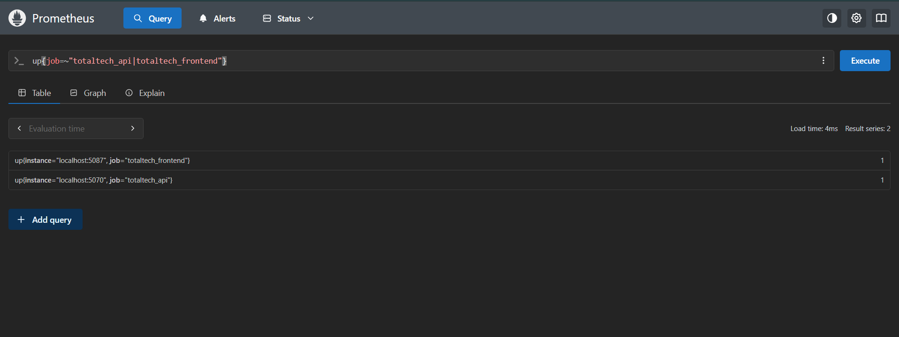
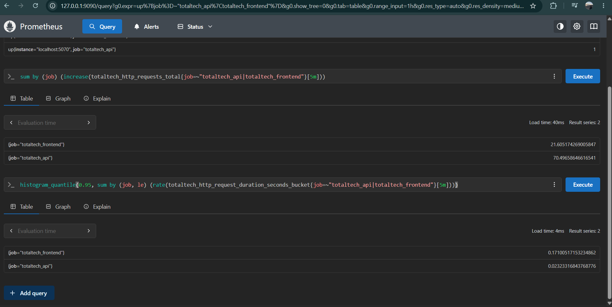
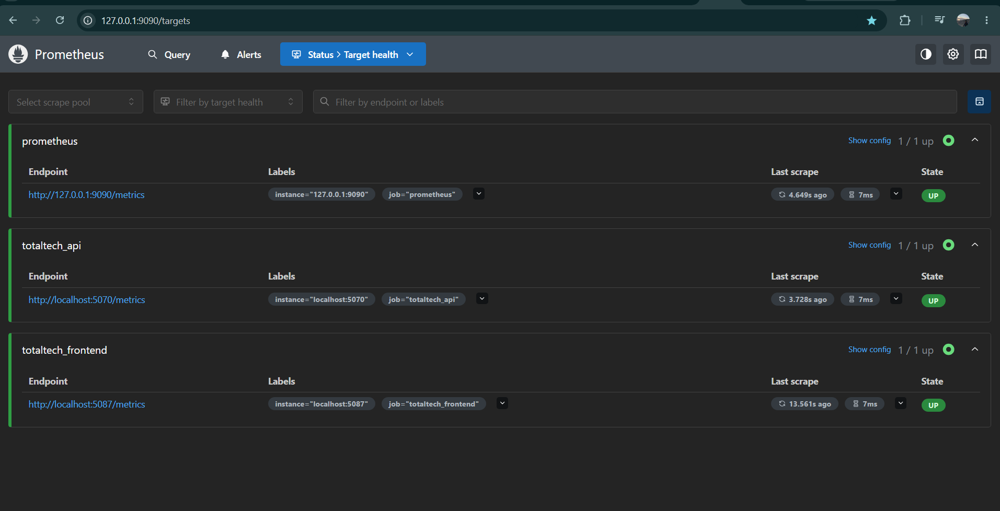

# Prometheus en TotalTech: tres métricas básicas

TotalTech integra Prometheus para consultar métricas de la API y del frontend. Cada aplicación publica sus datos en `/metrics`, y Prometheus los recolecta periódicamente en el entorno local.

Las siguientes capturas muestran la implementación funcionando en el momento en que fueron tomadas.

## 1. Disponibilidad de la API y del frontend

Permite comprobar si Prometheus puede recolectar las métricas de cada aplicación: **1** significa que la extracción fue exitosa y **0** que falló. Esto no comprueba por sí solo todas las funciones del sistema.

```promql
up{job=~"totaltech_api|totaltech_frontend"}
```

En la captura, ambas aplicaciones devuelven **1**.



## 2. Solicitudes HTTP en los últimos 5 minutos

Muestra cuántas solicitudes recibió cada aplicación durante esa ventana. Sirve para observar la actividad del sistema. El resultado es una estimación y puede incluir decimales.

```promql
sum by (job) (
  increase(totaltech_http_requests_total{job=~"totaltech_api|totaltech_frontend"}[5m])
)
```

## 3. Latencia p95 de las solicitudes HTTP

Muestra el tiempo de respuesta estimado por debajo del cual se completó el **95 % de las solicitudes**, durante los últimos 5 minutos. Se expresa en segundos y ayuda a detectar demoras. No es un promedio y necesita tráfico para producir resultados útiles.

```promql
histogram_quantile(
  0.95,
  sum by (job, le) (
    rate(totaltech_http_request_duration_seconds_bucket{job=~"totaltech_api|totaltech_frontend"}[5m])
  )
)
```

Esta captura muestra las consultas de solicitudes HTTP y latencia p95:



## Servicios monitoreados

La pantalla **Targets** muestra a Prometheus, la API y el frontend en estado **UP**, confirmando que se podían recolectar sus métricas en ese momento.



Para iniciar Prometheus y consultar más detalles, ver la [guía de observabilidad](Observabilidad.md).
